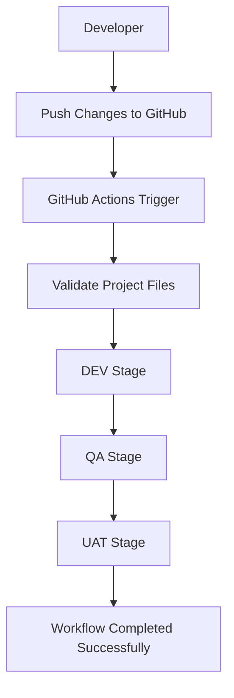

# 🛡️ Insurance Domain Data Engineering Project

## 1. Project Overview

The Insurance Domain Data Engineering Project is an end-to-end data engineering and analytics solution designed to manage, process, transform, and visualize insurance data.

The project follows the Medallion Architecture (Bronze, Silver, and Gold) using Databricks to process data from Supabase. The transformed Gold-layer data is used to build an interactive analytics dashboard in Databricks and a Power BI report.

The main objective is to build a reusable data pipeline that supports incremental data updates and provides meaningful insights into customers, policies, claims, payments, agents, and insurance products.

## 2. Technologies Used

- **Supabase (PostgreSQL):** Source database.
- **Databricks:** Data ingestion, processing, and transformation.
- **SQL / PySpark:** Data processing and transformation.
- **Delta Tables:** Storage of processed data.
- **Power BI:** Business intelligence and reporting.
- **GitHub:** Source code management and version control.
- **GitHub Actions:** CI/CD workflow automation.

## 3. Project Architecture

The project follows the Medallion Architecture.

**Source → Bronze → Silver → Gold → Databricks Dashboard → Power BI**

### Bronze Layer – Data Ingestion

- Ingests source data from Supabase into Databricks.
- Maintains raw data in Bronze tables.
- Includes ingestion queries for all six source tables.
- Implements incremental customer ingestion using an `updated_at` timestamp and watermark tracking.
- Supports new records and updated records.

### Silver Layer – Data Transformation

- Processes data from the Bronze layer.
- Performs data cleaning and transformation.
- Maintains structured and refined datasets.
- Uses MERGE operations to handle new and updated customer records.
- Ensures data consistency between Bronze and Silver layers.

### Gold Layer – Business-Level Data

- Creates dimension and fact tables for analytics.
- Organizes data using a star-schema approach.
- Provides business-ready data for dashboards and reporting.

**Gold Dimension Tables:**
- dim_customer
- dim_agent
- dim_date
- dim_policy
- dim_product

**Gold Fact Tables:**
- fact_policy
- fact_claim
- fact_payment

## 4. Source Database Tables

The project uses six main source tables from Supabase:

1. customers
2. agents
3. insurance_products
4. policies
5. claims
6. payments

The database schema is maintained in the `database/schema.sql` file.

## 5. Incremental Data Processing

Incremental processing is implemented to capture customer record updates.

An `updated_at` timestamp is maintained in the source customer table. When a customer record changes, the timestamp is updated automatically.

The pipeline identifies changed records and propagates updates through the Bronze, Silver, and Gold layers using MERGE operations.

### Customer Update Validation

A customer location update was successfully tested.

- Customer ID: 7
- Original city: Chennai
- Updated city: Hyderabad

The updated location was successfully propagated through the Bronze, Silver, and Gold layers and verified in the Gold customer dimension table.

The updated customer location was also displayed in the Databricks analytics dashboard.

## 6. Databricks Dashboard

An interactive Insurance Analytics Dashboard was developed using Gold-layer tables.

The dashboard includes:

- Total Customers
- Total Policies
- Total Premium
- Total Claims
- Claim Amount by Status
- Payment Amount by Payment Method
- Premium by Product
- Coverage by Product
- Policy Status
- Customer Location Details

The dashboard provides a consolidated view of insurance business performance.

## 7. Power BI Integration

Power BI is integrated with Databricks to provide interactive business reporting.

The Gold-layer dimension and fact tables are used to create a star-schema-based data model.

The Power BI report includes:

- Total Customers
- Total Policies
- Total Premium
- Total Claims
- Claim Amount by Status
- Payment Amount by Payment Method
- Premium by Product
- Policy Status

The report uses relationships between dimension and fact tables to support business analysis and visualization.

## 8. GitHub Version Control

GitHub is used to maintain and manage the project files.

The repository contains:

- Database schema
- Bronze SQL queries
- Silver SQL queries
- Gold SQL queries
- Source CSV files
- Databricks dashboard export
- Power BI report
- Project screenshots
- README documentation
- GitHub Actions workflow

GitHub provides centralized source code management and version control for the project.

## 9. CI/CD Pipeline Using GitHub Actions

GitHub Actions is used to implement a CI/CD workflow for the Insurance Domain Project.

The workflow is maintained in:

`.github/workflows/deploy.yml`

### CI/CD Workflow Stages

**1. Source Code Management**

Project changes are maintained in the GitHub repository.

**2. Continuous Integration**

The workflow is automatically triggered when changes are pushed to the `main` branch or when a pull request targets `main`.

**3. Project Validation**

The workflow checks the availability of essential project files, including:

- README.md
- database folder

**4. Deployment Workflow**

After validation, the workflow executes three sequential stages:

- **DEV:** Development deployment stage.
- **QA:** Quality Assurance deployment stage.
- **UAT:** User Acceptance Testing deployment stage.

### CI/CD Workflow Diagram



### Workflow Execution Result

The GitHub Actions workflow was executed successfully.

- **Workflow Name:** Insurance Project CI/CD
- **Workflow File:** deploy.yml
- **Branch:** main
- **Execution Status:** Success
- **Execution Time:** 25 seconds
- **Validation Job:** Successful
- **DEV Job:** Successful
- **QA Job:** Successful
- **UAT Job:** Successful

The workflow execution and job results can be monitored through the GitHub Actions tab.

## 10. Project Outcomes

- Implemented Bronze, Silver, and Gold data architecture.
- Ingested six insurance-related source tables.
- Implemented data transformation and incremental customer updates.
- Created dimension and fact tables using a star-schema approach.
- Successfully tested customer location updates across the data layers.
- Developed an interactive Databricks analytics dashboard.
- Integrated Databricks Gold-layer data with Power BI.
- Created Power BI visualizations for insurance analytics.
- Maintained project SQL files, reports, and documentation in GitHub.
- Implemented a GitHub Actions workflow with file validation and sequential DEV, QA, and UAT stages.
- Successfully executed and verified the GitHub Actions workflow.

## 11. Repository Structure

```text
insurance-domain-project/
│
├── database/
│   └── schema.sql
│
├── Bronze SQL Queries
├── Silver SQL Queries
├── Gold SQL Queries
│
├── Insurance Analytics Dashboard
├── Power BI Report
├── Screenshots
│
├── agents.csv
├── claims.csv
├── customers.csv
├── insurance_products.csv
├── payments.csv
├── policies.csv
│
├── .github/
│   └── workflows/
│       └── deploy.yml
│
└── README.md
```

## 12. Conclusion

The Insurance Domain Data Engineering Project demonstrates an end-to-end insurance data engineering and analytics workflow using Supabase, Databricks, SQL, Delta tables, Power BI, GitHub, and GitHub Actions.

The project covers source data ingestion, incremental processing, data transformation, dimensional modeling, business intelligence reporting, version control, and automated workflow execution.

By combining data engineering and business intelligence technologies, the solution provides a structured and reusable approach to processing insurance data and generating meaningful business insights.
